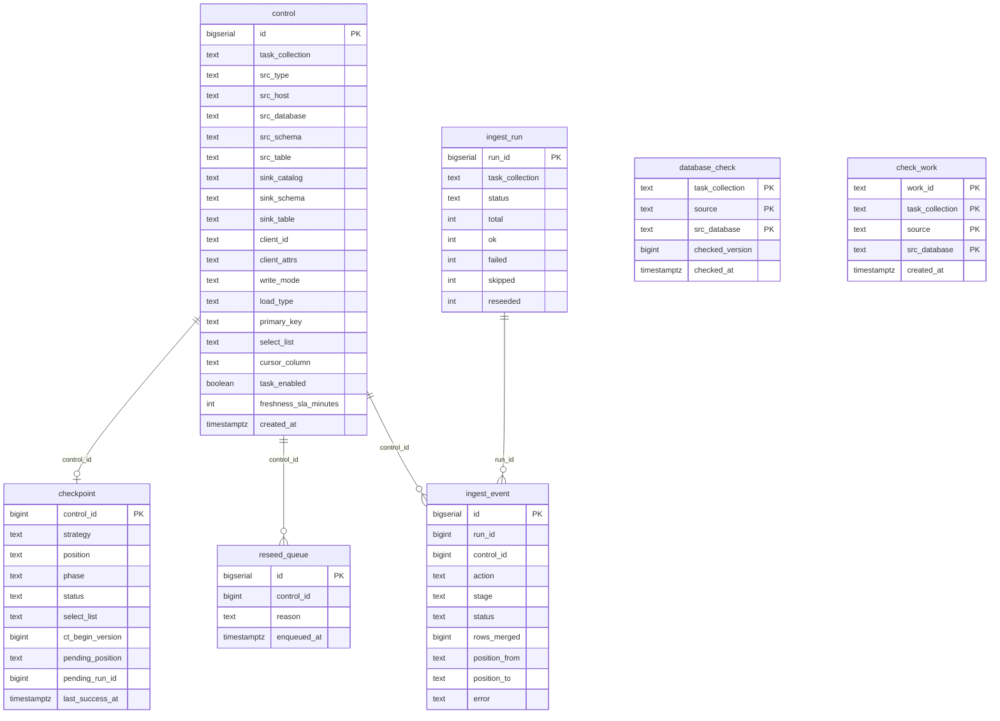
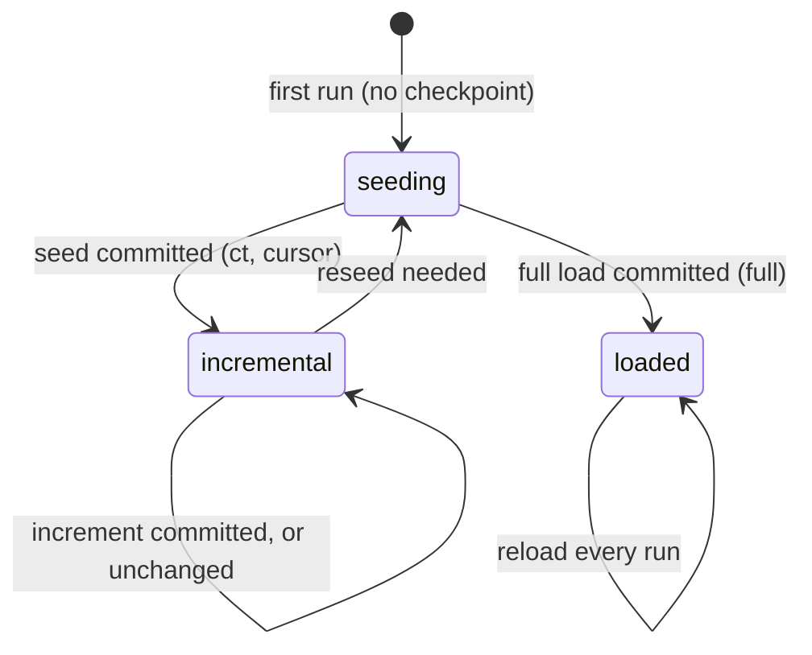

# Lakebase schema

All state for the default version lives in one Lakebase (Postgres) database, schema
`lakefed_ingest`. The DDL is [`src/lakefed_ingest/lakebase_schema.sql`](../src/lakefed_ingest/lakebase_schema.sql),
applied by the `lakefed_ingest_setup` job on a new deployment and migrated by the first ingestion run
after an upgrade (see `schema_version` below). The database is registered in Unity Catalog
(default catalog `lakefed_ingest_lakebase`), so every table below can be queried from a SQL warehouse
as `lakefed_ingest_lakebase.lakefed_ingest.<table>` (see [monitoring.md](monitoring.md)).

| Table | Role | Written by |
|---|---|---|
| `control` | **Configuration.** One row per source table to ingest | You (load control rows) |
| `checkpoint` | **State.** Where each table is: phase, resume position, status, freshness | The ingestion job |
| `database_check` | **State.** One check stamp per unchanged source database, in place of a stamp per table | The ingestion job, and the check job |
| `check_work` | **State.** The databases with work for each run the check job starts | The check job |
| `reseed_queue` | **Log.** Every reseed the job queued, and why | The ingestion job |
| `ingest_run` | **Telemetry.** One row per job run | The ingestion job |
| `ingest_event` | **Telemetry.** One row per table per run | The ingestion job |
| `control_change` | **Audit.** Every change the operations app makes to control rows | The operations app |
| `discovery`, `discovered_table` | **Onboarding.** Tables found by the discovery job, with recommended control-row settings | The discovery job |
| `schedule`, `schedule_member` | **Scheduling.** Cadences for running collections, and the wrapper job per (schedule, collection) | The operations app |
| `databricks_run` | **Telemetry.** The Databricks runs the operations app shows, with their state | The operations app's run poller |
| `schema_version` | **Bookkeeping.** Schema versions applied | The setup job, or the first ingestion run after an upgrade |



The diagram shows the key columns only; the full lists are below. The relationships are logical
(by id) and not enforced with foreign keys. Deleting a `control` row leaves its checkpoint and
history behind, which is harmless: a row added again later gets a new `id`, so it seeds from
scratch.

## `control` — what to ingest

One row per (source database, table). You maintain it; the job only reads it (one query per run,
for the run's `task_collection`). See "Control rows" in the [README](../README.md) and
`notebooks/load_control_example.ipynb`.

| Column | Meaning |
|---|---|
| `id` | Primary key. Checkpoints and telemetry refer to it as `control_id` |
| `task_collection` | Which run ingests this row. One job run = one collection |
| `task_enabled` | `false` skips the row without deleting its state |
| `tier`, `priority` | Order within a run (`tier`, then `priority`, then `id`) |
| `freshness_sla_minutes` | Optional freshness SLA: an enabled table breaches it when its `checkpoint.last_success_at` (or, if it has never succeeded, `created_at`) is older than this many minutes. NULL = no SLA, never flagged. Monitoring only (the operations app and DBSQL alerts); the ingestion job doesn't read it. Set it to the collection's schedule plus run time plus slack, e.g. 45 for a 15-minute schedule |
| `created_at` | When the row was added (rows that predate this column show the migration time) |
| `src_type` | Source adapter: `sqlserver` \| `oracle` \| `postgresql` \| `mysql` |
| `src_host`, `src_port` | Source server; NULL port = the engine's default (no `src_host`: the connection's port) |
| `src_database`, `src_schema`, `src_table` | Source table (Oracle: `src_database` is the service name) |
| `secret_key` | Secret (in the job's secret scope) holding JSON `{"user", "password"}` for this database |
| `use_remote_query` | `true`: read through the Unity Catalog connection in `src_connection` (`remote_query`) instead of Spark JDBC; `src_host`, `src_port` and `secret_key` aren't used then. Default `false` |
| `src_connection` | Connection read through when `use_remote_query` is `true`. Otherwise, with `src_host` NULL, the host and a NULL `src_port` come from its options |
| `jdbc_options` | Optional JSON object of extra Spark JDBC read options |
| `select_list` | Explicit, comma-separated columns to copy (`*` isn't supported). Adding a column reseeds the table |
| `primary_key` | Comma-separated; required for `ct`, `cursor` and `cdc` (MERGE key) |
| `sink_catalog`, `sink_schema`, `sink_table` | Target Delta table |
| `client_id` | Optional. Set it to share one sink across many source databases; written to the sink column `__client_id__` |
| `client_attrs` | Optional JSON object `{column: value}`: identity columns written (as STRING) on every row, e.g. the tenant name or source server |
| `write_mode` | `merge` (default): the sink mirrors the source table. `append` (`ct` and `full`): the sink is a change log (see "Append sinks" in the [README](../README.md)) |
| `load_type` | Load strategy: `ct` \| `cursor` \| `full` (`cdc` is a placeholder) |
| `cursor_column` | `cursor` only: the high-watermark column (rowversion recommended) |
| `load_partitioned`, `partition_col`, `partition_size_mb` | Optional partitioned seed / full load for large tables |
| `ct_enabled` | Informational for `ct` rows; the job checks Change Tracking on the source itself |
| `cdc_capture_instance` | Reserved for the placeholder `cdc` strategy |
| `job_name`, `src_catalog`, `warehouse_id`, `enable_iceberg_reads`, `sink_cluster_cols`, `source_instance_group` | Not used by this version (shared with the job orchestration version, or reserved). Leave NULL / default |

**Constraints.** CHECK constraints reject invalid combinations, for example:
- `ct` on a source other than SQL Server, or without a primary key;
- `cursor` without `cursor_column`;
- partitioned settings that are incomplete;
- `jdbc_options` or `client_attrs` that isn't a JSON object;
- `use_remote_query` without `src_connection`;
- a malformed `client_id`;
- `write_mode` other than `merge` / `append`, or `append` with a load type other than `ct` / `full`.
- a `freshness_sla_minutes` that isn't positive.

A unique index allows only one row per sink, or one row per (sink, `client_id`) for shared sinks,
so two rows can never overwrite each other's data.

## `checkpoint` — where each table is

One row per control row (`control_id` is the primary key), created on the table's first run and
updated after every successful write. The job reads all of a collection's checkpoints in one query
at the start of a run.

| Column | Meaning |
|---|---|
| `control_id` | The control row this state belongs to |
| `src_database`, `src_schema`, `src_table` | Copied from control, for readability |
| `strategy` | Load strategy that wrote the row (`ct`, `cursor`, `full`). A different `load_type` in control means a reseed |
| `phase` | `seeding` (needs a full copy) → `incremental` (seeded; applying increments, for `ct` and `cursor`); `loaded` for `full` |
| `position` | Resume point, owned by the strategy. `ct`: the source database's CT version. `cursor`: JSON `{"col", "type", "value"}` (the watermark). `full`: NULL |
| `status`, `detail` | `ok` or `failed`, with the last error in `detail` |
| `select_list` | Columns the sink was last written with; compared with `control.select_list` to detect added columns |
| `source_identity`, `sink_identity`, `merge_key` | What the checkpoint was written for: `engine://host:port/db/schema/table`, the sink (`catalog.schema.table`, plus `#client_id` for a shared sink) and the normalized primary key. A control row that now points elsewhere reseeds (`source_changed`, `sink_changed`, `primary_key_changed`). NULL until first recorded |
| `ct_begin_version` | `ct`: the table's Change Tracking begin version at seed time. A change means CT was turned off and on, so the table reseeds |
| `pending_position`, `pending_run_id` | Append sinks (`ct`): set just before a change or seed append, to the position it reaches and the run writing it; cleared when the checkpoint advances. Set at the start of a run means the last run stopped in between: the job checks the sink for that run's rows before doing anything else with the table. A `full` append isn't marked: each run appends one complete snapshot tagged with its `__run_id`, so a run that stopped after its commit leaves a complete snapshot and the next run appends its own |
| `last_success_at` | When the table last ingested successfully, used for freshness and lag. A `ct` table whose database has a vouching `database_check` stamp was last confirmed current at the later of the two (see below) |
| `updated_at` | Last change to this row |

**Lifecycle.** Checkpoints only move forward after the Delta commit succeeds, so a failure never
skips data; the next run redoes that window and the MERGE is idempotent.



A table reseeds when Change Tracking retention lapsed, CT was turned off or re-enabled on it,
`select_list` gained columns, `cursor_column` or `load_type` changed, its source, sink or primary
key changed, or its sink table no longer exists (`sink_missing`).

**Forcing a reseed.** Set the phase back to `seeding`; the next run copies the table again:

```sql
-- Clear any pending append too: a run settles it before looking at the phase, which would undo the reseed.
update lakefed_ingest.checkpoint set phase = 'seeding', status = 'ok', pending_position = null, pending_run_id = null
where control_id in (...);
```

## `database_check`: one check stamp per unchanged database

When every table of a source database is unchanged (nothing to read, no seed, reseed or pending
append, and every incremental table's sink exists), a run writes one row here instead of stamping `last_success_at` on each of its tables: the database's CT version when checked (`checked_version`),
`checked_at`, the number of `tables` and the `run_id`. It is keyed by the collection, the database's
server identity (`source`: host or connection, port, credential, as `state_store.database_source`)
and `src_database`. The stamp vouches for a `ct` table of that database in phase `incremental` whose
`position` is at or past `checked_version`; for those tables, the last success is
`greatest(checkpoint.last_success_at, database_check.checked_at)`. A table behind the version (it
changed since), re-seeding, or of another strategy reads its own stamp only.

In the key, a blank port is the source type's default port (1433 sqlserver, 1521 oracle, 5432 postgresql,
3306 mysql; 0 for an unknown type), so a row with a blank port and one with the default share a stamp. The
exception is a connection-backed row (no `src_host`): its host and port come from the UC connection, whose port
the control row does not carry, so its blank port stays 0.

The key changed in this version without a schema change. A database whose rows have a host and a blank port
was stamped under `|0|` before, and that key is no longer read. Each such database is checked once more: its
tables are detected and, when nothing changed, it is stamped under the new key. Until that check runs, its
tables read their own `last_success_at`, which an unchanged database does not advance, so the freshness SLA can
show them late for about one check cycle. The old rows stay in `database_check`; nothing deletes or rewrites
them, and they are never read. Connection-backed stamps keep their key and stay valid.

## `check_work`: the check job's work list

The check job writes here, under one `work_id`, the databases of a collection that have work, then
starts that collection's run with the `work_id`; the run ingests only those databases. Keyed by
`work_id`, the collection, `source` (as in `database_check`) and `src_database`. A job parameter
could not carry the list (job parameter values are at most 10,000 characters). The check deletes
rows older than a week.

## `reseed_queue` — reseed log

One row every time the job queues a reseed: the table, its `control_id`, `reason`
(`retention_miss`, `schema_change`, `ct_disabled`, `ct_reenabled`, `ct_version_reset`) and
`enqueued_at`. It's an audit log. The reseed itself happens because the same step sets the
checkpoint's phase to `seeding`. `processed` / `processed_at` are reserved and not currently set.

## `ingest_run` — one row per run

Inserted when a run starts (`status = 'running'`) and finalized when it ends.

| Column | Meaning |
|---|---|
| `run_id` | Primary key; `ingest_event.run_id` refers to it |
| `task_collection` | Collection the run ingested |
| `job_run_id`, `cluster_id` | The Databricks job run and cluster, for cross-referencing the Jobs UI |
| `parallelism` | The run's concurrency budget |
| `started_at`, `finished_at` | Timing |
| `status` | `running` → `completed` \| `failed` (any table failed, or a run with a `work_id` found the collection locked by another run: its databases were not ingested); `skipped` when another run of the same collection held the lock and the run had no `work_id`; a check run that raised is `failed` with `detail.check.error` |
| `total`, `ok`, `failed` | Table counts (`total` holds the tables the run planned while it runs) |
| `skipped` | Tables that were unchanged (nothing to read) |
| `reseeded` | Tables queued for a reseed |
| `work_id` | The check job's work list the run was started for (`<launch_id>:<collection>`): the runs of one launch share its launch id, and the operations app shows them as one job run. `check-<job run>` on the check job's own record of a check (`detail.check` holds what it found): not a group run, so leave these rows out when counting or timing runs. Null for a run started otherwise |
| `detail` | JSON with run details: change-detection counts per route, timings, peak concurrency, and with `max_queries_per_source` set, each source's share and peak permits (`source_caps`), the rows batched appends committed (`batch_rows`, with `batch_rows_unknown` tables not counted), and table retry totals (`table_retries`) |

## `ingest_event` — one row per table per run

Inserted when a table starts (`status = 'running'`) and updated when it finishes. Tables that fail
before any work (stage `plan` or `detect`) also get a `failed` event. CT tables that skip-no-change
finds unchanged don't get an event: they're advanced in bulk, counted in `ingest_run.skipped`, and
their `checkpoint.last_success_at` is still stamped (or, for a whole unchanged database, its
`database_check` row). Cursor tables always get one, with no rows
when the watermark hasn't moved.

| Column | Meaning |
|---|---|
| `id` | Primary key |
| `run_id`, `task_collection`, `control_id` | Which run and which control row |
| `src_database`, `src_schema`, `src_table`, `sink_fqn` | Source and target, copied for convenience |
| `action` | `seed`, `increment`, `reseed` or `full` |
| `phase` | Checkpoint phase when the table started |
| `stage` | How far it got: `plan`, `detect`, `verify` (checking a pending append), `ensure_sink`, `read`, `seed`, `merge`, `load`, `checkpoint`. On a failure, this is where it failed |
| `status` | `running` → `ok` \| `failed`; `skipped` for a reseed that was only queued (no data copied); `retried` for an attempt that failed and was tried again in the same run (`table_retries`), so the table has a later row for its next attempt |
| `started_at`, `finished_at`, `duration_ms` | Timing |
| `rows_read`, `rows_merged` | Row counts from the Delta commit metrics (NULL when the runtime doesn't report them) |
| `position_from`, `position_to` | Checkpoint position before and after (CT version, or cursor value) |
| `pool` | Spark FAIR pools the table's work ran in; `batch<size>` for a member of a batched append, whose rows are in the run's `detail.batch_rows`, not in `rows_merged` |
| `error` | Error message for a failed or retried attempt, with its deepest Java cause when Spark's message leaves it out |
| `retry_count` | Earlier attempts of this table in the run: 0 for the first, 1 for the first retry. Write-conflict retries inside an attempt are logged in the job output only |

Indexes for the operations app's history reads (schema version 8): runs by `started_at` across every
collection; failed events by `started_at`; and each table's first loads (`ok` events of `seed`, `reseed` or
`full`) by collection, control row and time, so a database's rows are read without passing over the
collection's other events. Like every migration they are built in the upgrade's one transaction, which holds
the telemetry tables' write lock while it builds them: on a database with years of history, run
`lakefed_ingest_setup` at a quiet time rather than leave the upgrade to the next ingestion run.

## `control_change` — change log

Written by the operations app in the same transaction as each change. Columns:
- `changed_at`, `changed_by` (the signed-in user);
- `action`: `add`, `register`, `edit`, `enable`, `disable` or `reseed`, or for schedules
  `schedule_create`, `schedule_edit`, `schedule_pause`, `schedule_resume`, `schedule_delete`,
  `schedule_sync`;
- `control_id`, and `task_collection` (the row's collection after the change);
- `field`, `old_value`, `new_value`, for edits;
- `reseed_reason`, when the change flipped the table to seeding;
- `batch_id`, which groups the rows of one bulk action.

Edits made directly with SQL aren't logged, but the job still reseeds a table whose source, sink or
key changed (see `checkpoint`).

## `discovery` and `discovered_table` — bulk onboarding

Written by the `lakefed_ingest_discover` job, which reads source catalog metadata only, and reviewed
in the operations app's Bulk import page.
- **`discovery`:** one row per (discovery, database), with the source read: a Unity Catalog connection
  (`src_connection`, read through `remote_query` with no secret) or a host (`src_host`, `src_port`,
  `secret_key`); `status` (`running` | `ok` | `failed`, or `listed` for a discovery that only lists the server's
  databases, as Test connection does), `error`, and the number of tables found. A connection that fails is recorded
  on the server's `master` row. `listing` (JSON, schema version 11): how it listed its databases, for a later
  re-discovery: `pattern`, `azure_credential`, `azure_resource_id` and `secret_key_template`. Never a secret. Null
  for discoveries made before version 11.
- **`discovered_table`:** one row per table, with size and row counts, whether Change Tracking is
  enabled, and the recommended settings: `select_list` (unsupported column types listed in
  `excluded_columns`), `primary_key`, `load_type` (`ct` if CT and a PK; `cursor` on a rowversion
  column if a PK; else `full`), `cursor_column`, and `partition_candidate`. Partitioning itself is
  decided at review from a size threshold.

Nothing here is used by ingestion; control rows are created only when a reviewer registers tables.

## `schedule` and `schedule_member` — scheduling

Written by the operations app (see "Schedules" in `app/README.md`); the ingestion job doesn't read them.
- **`schedule`:** `name` (unique among active schedules), `cadence_minutes` (5, 10, 15, 20, 30, 60, 120,
  180, 240, 360, 720 or 1440), `timezone`, `parameters` (ingestion job parameters, JSON), `job_variant`,
  `stagger`, `paused`, `notify_emails`, `options` (JSON, null = none: `start_minute`, a set start time in
  minutes after local midnight for daily and every 2 to 12 hours schedules; `rediscover_hour`, the UTC hour of the
  job's daily re-discovery, absent when off; `rediscovery`, the last re-discovery's record, written by the app),
  who created it and when, and
  `deleted_at` (soft delete).
- **`schedule_member`:** one row per (schedule, collection): `offset_minutes` (start offset within the
  cadence: the schedule's start time plus the member's stagger), `job_id` (the wrapper job the app created), `synced_at`, `sync_error`, and `removed_at`
  (soft remove; the next sync deletes the wrapper job).

## `app_task`: the app's background writes

Written by the operations app (schema version 9). A New ingestion job, Add tables or databases file of more than
5,000 tables is written off the request, so the browser never waits on it: the request records a task and answers
at once, and a thread in the app writes the tables in one transaction, 1,000 to a statement. Columns:
- `kind` (`create`, `tables` or `databases`), `job_id` (the ingestion job, once known), `created_by`;
- `request_id`: unique; the page sends one per Create or Add, so the same request sent again (a retry after a
  timeout) finds the same task instead of writing twice;
- `status` (`running`, `succeeded` or `failed`), `done` of `total` tables, `result` (what the request would have
  answered), `error`;
- `created_at`, `heartbeat_at` (moved every 2 seconds while the thread runs), `finished_at`.

The write's last statement, in its own transaction, sets `result`, so the result commits with the tables or not at
all. A running task whose heartbeat stopped for 2 minutes (the app restarted) is ended when it is next read: with
no `result` it failed and its transaction was rolled back with the app, so nothing of it was written and it can be
sent again; with a `result` its tables were written and only the sync of the job's Databricks jobs was missed.

## `table_upload` and `table_upload_line`: CSV files of tables

Written by the operations app (schema version 9). New ingestion job and Add tables post a CSV of tables once
(`POST /api/uploads`); it is kept here, so the pages show its servers and databases and page its tables from
Lakebase, and Create names the upload and what of it to take instead of sending the file again.
- `table_upload`: one row per file: `upload_id`, `file_name`, `uploaded_by`, `uploaded_at`, `columns` (its header),
  `lines`, `tables` (lines that can be taken) and `invalid`.
- `table_upload_line`: one row per line, keyed by (`upload_id`, `line`, the file's line number): `server` (its UC
  connection, or host and port), `src_database`, `src_schema`, `src_table`, `load_type` (the file's own, if any),
  `fields` (the line as read, `{column: value}`), `status` (`ok`, or `invalid` when it can't name a table on a
  server) and `errors`. Indexed by (`upload_id`, `server`, `src_database`) for the database view.

Uploads are kept: the app has no DELETE privilege. Prune old ones by `uploaded_at` as the database's owner.

## `job_selection`: what an ingestion job was made from

Written by the operations app (schema version 9), in the transaction that writes the job's tables, when they were
chosen from an upload or a discovery. One row per part: `job_id`, `scope` (`server`: every database of the server
matching `filter`; `database`: a whole database; `tables`: the `tables` named, as schema.table), `server`,
`src_database`, `source_kind` (`discovery` or `upload`) and `source_id`, `created_by`, `created_at`. A later
re-discovery reads it: a whole server takes its new databases, a whole database its new tables, chosen tables
nothing more (see Re-discovery in [app/README.md](../app/README.md)). Tables given as CSV lines in the request body
record nothing here. A job's Delete removes its rows:
the delete job (`lakefed_ingest_delete_job`) deletes them in the transaction that deletes the job's groups.

Telemetry tables grow with every run. To keep long-term history cheaply, snapshot them to Delta
(see [monitoring.md](monitoring.md)) and prune old rows from Lakebase.

## `databricks_run`: the Databricks runs the app shows

Written by the operations app's run poller (`app/src/run_poller.py`), which lists each job the app shows runs of every
15 seconds and writes a run only when its state changed. The pages read this table rather than the Jobs API.
- **`run_id`** (primary key), **`job_id`**, and **`kind`**: `wrapper` (a schedule's wrapper job), `check`, `group` (the
  ingestion job, its variants and a schedule's cluster copy), `setup`, `discover`, `delete`, or `copies`.
- **`schedule_id`** (wrapper, group copy and check runs) and **`task_collection`** (what the run ingests).
- **`trigger`**, **`parameters`** (the run's job parameters, JSON), **`life_cycle_state`** (QUEUED ... TERMINATED,
  SKIPPED, INTERNAL_ERROR, or NOT_FOUND when the Jobs API has no such run), **`result_state`**, **`state_message`**,
  **`run_page_url`**, **`started_at`**, **`ended_at`**, and **`seen_at`** (when the poller last saw a change).
- The app has no DELETE on Lakebase, so rows are never removed: prune old ones as the owner, as with `ingest_run`.
- Added by the schema version that created it. Its statements are `create table if not exists` and `create index if not exists` only,
  so the upgrade takes no lock on an existing table.

## `schema_version` — schema versions applied

One row per version (`state_store.SCHEMA_VERSION`) applied: `version`, `applied_at`, `applied_by`.
An ingestion run whose code needs a newer version than the newest row applies the DDL and pending
renames first, in one transaction, under an advisory lock (so runs of other collections wait for it
rather than migrating twice); a failure changes nothing. A database without the table (deployed
before versions were recorded) counts as version 0.

## Removing tables and old history

Neither the ingestion job nor the operations app deletes configuration or history (a re-run
discovery replaces only its own `discovered_table` rows), and the app has no `DELETE` privilege.
The one exception is an app job's Delete: the `lakefed_ingest_delete_job` job, run as the deployer, deletes that
job's groups' control rows and their state (run history and `control_change` stay), and, when asked, the target
tables only they write (`src/lakefed_ingest/delete_job.py`).

**To stop ingesting a table,** disable it: `task_enabled = false`, or **Disable** in the app. Runs skip
it from then on; it's reversible and logged.

**To remove it for good,** connect to Lakebase as the tables' owner (the identity that ran setup) and
delete its control row and checkpoint in one transaction, holding the collection's run lock so the
delete can't race a running collection (the same lock the app takes for its edits):

```sql
begin;
-- true = locked; false = the collection is running: roll back and retry later
select pg_try_advisory_xact_lock(hashtextextended('lakefed_ingest:<task_collection>', 0));
delete from lakefed_ingest.checkpoint where control_id in (...);
delete from lakefed_ingest.control where id in (...);
commit;
```

- No foreign key points at `control`, so that order is enough. Run history (`ingest_run`,
  `ingest_event`), `reseed_queue` and `control_change` can stay: nothing reads them to decide what to
  ingest.
- **The sink isn't touched.** A dedicated sink: drop it in Unity Catalog if you don't need it. A
  shared sink: `DELETE FROM <sink> WHERE __client_id__ = '<client_id>'` removes that database's rows.
- **Schedules:** delete them in the app. It deletes their wrapper jobs and marks the schedule deleted.
- **Old run history:** snapshot `ingest_run` and `ingest_event` to Delta ([monitoring.md](monitoring.md)),
  then delete old rows as the owner, e.g.
  `delete from lakefed_ingest.ingest_event where started_at < now() - interval '90 days';`
- **Old discoveries:** `delete from lakefed_ingest.discovered_table where discovery_id = '...';`, then
  the same for `discovery`.

## Changing the schema

An upgrade re-reads the whole of `lakebase_schema.sql`, plus the pending `state_store.RENAMES`, and runs
them against a database at any earlier version. `StateStore.migrate` skips a statement the catalog
(`pg_catalog`) shows is already in place: a table or index that exists, a column that exists with the same
type, nullability and default, or a backfill whose probe query (`UPDATE_PROBES`) finds no rows. A statement
it can't decide from the catalog still runs. A fresh database runs the whole file. So every statement must be:

- **Idempotent:** safe to run again. Use `create ... if not exists`, `add column if not exists`, and
  `drop constraint if exists` right before `add constraint`. A backfill (`update`) must be a no-op
  once applied, for example `where control_id is null`.
- **Additive:** no `drop table`, `drop column` or `truncate`. A change that can't be written this way
  (a destructive change, a one-time step for one version) needs a per-version migration step, which
  the framework doesn't have yet.
- **Valid from any earlier version:** the statement may run on a database several versions behind.
- **Valid in a transaction:** no `CREATE INDEX CONCURRENTLY`, no `DO $$` blocks.

Renames go in `state_store.RENAMES`, which runs only the ones still pending. Prefer adding a column over
renaming one: add the new column, write both, move the readers, and drop the old one in a later version.

`tests/state_store_test.py` enforces this with no database. `test_ddl_statements_are_safe_to_re_apply`
checks each statement's form. A statement that changes an existing column or rows (`alter column`,
`update`) must be reviewed as a no-op once applied and listed in `REVIEWED_NON_ADDITIVE`. Then bump
`state_store.SCHEMA_VERSION` and add the new fingerprint to `SCHEMA_FINGERPRINTS`; the test says what to add.

### Locks and waiting

The whole migration is one transaction, and a statement that changes a table takes an `ACCESS EXCLUSIVE`
lock on it, held until the commit. So a migration waits for running loads that hold those tables. Each
attempt waits at most 3 s for a lock (`LOCK_TIMEOUT_S`, the Postgres `lock_timeout`). On a `55P03` timeout
the transaction is rolled back and the migration retries after 5, 10, 20, then 40 s, for up to 10 attempts
(`MIGRATE_ATTEMPTS`, about 5 minutes in all). If the last attempt times out, `StateStore.migrate` raises
`MigrationLockTimeout`, the setup job fails with a message to run it again, and nothing has changed.

An ingestion run that finds a migration pending and can't get it done does not ingest. It logs that the
migration waits, exits the notebook with `status: migration_waiting` and `schema_version` set, and the job
run succeeds. No `ingest_run` row is written for that run, and the next run tries the migration again.
Any other migration error still fails the run.

Two things still hold the locks for the whole transaction on every upgrade. The 14 constraint
re-declarations (`drop constraint if exists`, then `add constraint`, 28 statements) always run, because a
stored CHECK definition can't yet be compared with the file. Adding a CHECK validates every existing row, so
on `control` (the largest table) that holds an `ACCESS EXCLUSIVE` lock for the scan. Until those are decided
from the catalog or written as `NOT VALID` plus a later `VALIDATE`, an upgrade that touches the `control` or
`checkpoint` constraints should run between ingestion runs, not during them.

Upgrades that only add columns, tables or indexes are safe while runs are going. A version that renames,
or adds a constraint to a table the ingestion job writes, can fail tables of a run still on the old code
(they're redone by the next run): for those, pause schedules or deploy between runs.
